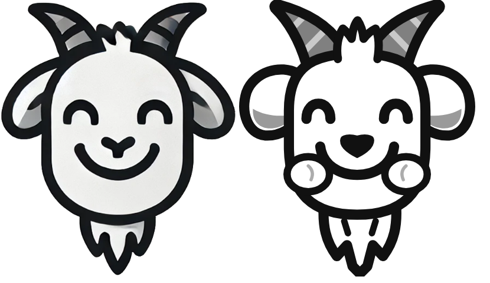
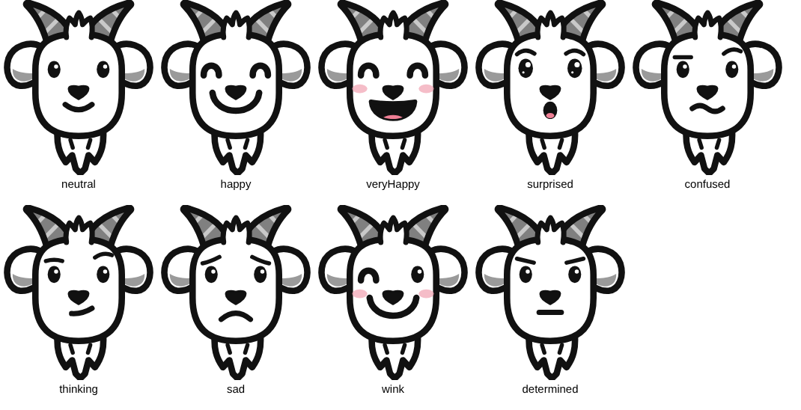
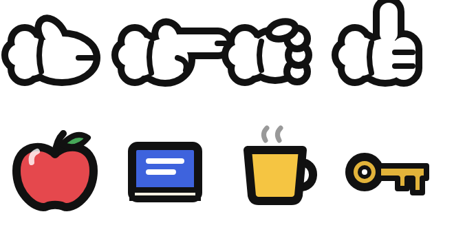
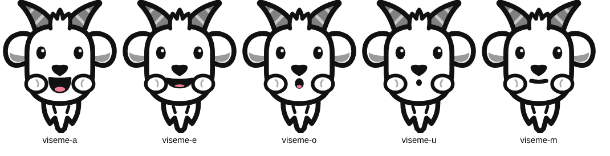

# Kielipukki

Kielipukki is a goat character for animated Finnish language lessons. It runs in the browser as SVG (Scalable Vector Graphics) and is animated with plain JavaScript, with no libraries.



## Run the demo

The rig is loaded with `fetch`, so the page must be served over HTTP (opening the file directly does not work):

```bash
python3 -m http.server 8000
```

Then open http://localhost:8000/demo/ for the character demo, or http://localhost:8000/lessons/ for the grammar lessons (see Grammar lessons below). In the demo, the buttons run each action, and "Play sample lesson" runs a short scripted lesson. In the browser console, `goat` is the character, so you can try calls such as `goat.pointAt('kuppi')`.

## Files

| Path | Contents |
| --- | --- |
| `assets/goat/rig.svg` | The character: head parts, face variants, hand poses and sample props |
| `assets/goat/reference.png` | The original drawing the rig was redrawn from |
| `assets/icons/` | 90 vocabulary pictures for 87 Finnish words, and `icons.json` listing each word |
| `src/kielipukki.js` | The controller that loads the rig and runs the actions |
| `src/emotions.js` | Emotion presets (which eyes, mouth and brows each emotion uses) |
| `src/icons.js` | Registers the vocabulary pictures as props |
| `src/sound.js` | Finnish speech and sound effects |
| `demo/index.html` | Demo page, word picker and sample lesson |
| `lessons/index.html` | Grammar lesson page |
| `src/lesson/` | Lesson engine, progress tracking, scene drawings, and one file per module in `modules/` |
| `tools/build-standalone.mjs` | Builds `dist/kielipukki.html` (the demo) and `dist/kielipukki-lessons.html` (the lessons), each as one file that works without a server |
| `tools/measure-icons.mjs` | Measures each picture's drawn area and stores it in `icons.json` |
| `tools/render-previews.mjs` | Renders the preview images in `docs/` |

To get the demo and the lessons as single files you can open directly or send to someone:

```bash
node tools/build-standalone.mjs
```

## Grammar lessons

`lessons/index.html` runs grammar modules with Kielipukki as the tutor. The design follows the "Finnish Grammar Modules" design doc: the tutor speaks only Finnish, the learner answers by acting (clicking and dragging), the things on screen share the same words so only the grammar form decides the answer, and after a mismatch the tutor describes what the learner actually did ("Otit pienemmän laatikon.") and repeats the request. He never says "wrong".

Each module has five stages:

1. **Watch**: Kielipukki points and narrates. Clicking things makes him describe them. "Next scene" goes on.
2. **Choose**: he says a sentence and the learner clicks the thing it means (6 tasks).
3. **Carry out**: he gives an instruction and the learner drags (6 tasks). "Anna minulle ..." means drag it to him.
4. **Mixed**: tasks from stages 2 and 3 in random order (10 tasks).
5. **Speech** (optional): a thing glows and the learner says what he should take. This uses the browser's speech recognition (Chrome or Edge) and the microphone, and can be skipped.

"Repeat" makes him say the sentence again, a little slower. Pressing it a second time in the same task also makes him point at the answer; that task then does not count towards Understands.

### Progress

Progress is kept in the browser (`localStorage`), per the design doc's tracking rules:

- **Understands**: a form answered correctly on the first try, in stage 2 or 3, on two separate days.
- **Produces**: a form said correctly in stage 5.
- **Module complete**: stage 4 finished with at most one mismatch in five tasks (2 of 10), on two separate days.

The diagnostic's starting values are set per module: in Module 4, the comparative forms start as "Meaning recognized".

### Module 4: Vertailu (comparative and superlative)

The first module built. Its scenes:

- **Boxes**: three sizes. "Ota isompi laatikko." "Laita pienempi laatikko isomman päälle." "Laita omena isoimpaan laatikkoon." "Anna minulle isoin laatikko."
- **Shop**: books and coats with price tags (halpa, kallis), books with star ratings (hyvä, parempi, paras), flowers from wilted to fresh (ruma, kaunis), and books with a reader's face from asleep to fascinated (tylsä, kiinnostava). "Tämä kirja on kalliimpi kuin tuo. Anna minulle halvempi kirja."
- **Family**: parents of different heights (pitkä, lyhyt), two boys and three children of different ages (vanha, nuori). "Kuka on perheen nuorin lapsi?" "Anna pallo vanhemmalle pojalle." "Anna hattu pidemmälle."

Things that only need to be looked at use the Mulberry icons; the boxes and the family are drawn in Kielipukki's style. Positions are shuffled every task, so where something stands never gives the answer away.

### Adding a module

A module is a file in `src/lesson/modules/` that exports `{ id, title, forms, initial, scenes, tasks, speech }`:

- `forms`: the forms it teaches, each with a label and a Finnish example (shown in the progress table).
- `scenes`: for stage 1, each with `setup(ctx)`, `watch(ctx, layout, say)` and `narrate(ctx, layout, id, say)`.
- `tasks`: each with `stages` (which of 2, 3, 4 it appears in) and `make(ctx)`, which sets up the stage and returns a task: `kind` ('click', 'drop' or 'give'), `say` (the instruction), `accept(action)`, `describe(action, ok)` (what he says about what the learner did), `forms`, `hint`, and for drops `movable`, `targets` and `place`.
- `speech`: stage 5 tasks, each returning `target`, `forms` and `match(transcripts)`.

`ctx` (a `SceneContext` in `src/lesson/engine.js`) has helpers to draw backgrounds, add boxes, icons with price tags, star ratings or reader faces, and people, and to find what is under a dropped thing.

## Vocabulary icons

`assets/icons/icons.json` lists each word:

```json
{ "id": "omena", "fi": "omena", "en": "apple", "files": ["omena.svg"],
  "match": "Direct meaning", "mulberry": ["apple"], "source": "mulberry",
  "note": null, "boxes": [[0.143, 0.083, 0.838, 0.92]] }
```

`id` is the Finnish word in lowercase ASCII (`pöytä` becomes `poyta`, `tuu tänne` becomes `tuu-tanne`). `match` says whether the picture shows the word directly, a related meaning, or is custom artwork. `boxes` is where the drawing sits inside each picture; run `node tools/measure-icons.mjs` after adding or changing pictures.

`registerIcons(goat)` makes every word a prop type named by its id, with its Finnish word as the label:

```js
import { registerIcons } from './src/icons.js';

const words = await registerIcons(goat);
goat.addProp('banaani', { x: 800, bottom: 592 });   // stands on a surface at y = 592
await goat.pointAt('banaani');
await goat.say(`Tämä on ${words.banaani.fi}.`);
```

Words with two pictures (käsi, jalka, mee pois) also get a second prop type named `<id>-2`.

Most pictures are Mulberry Symbols by Steve Lee, under CC BY-SA 4.0, which requires credit when you publish them. Three are custom artwork. See [assets/icons/LICENSE.md](assets/icons/LICENSE.md).

## Giving things to Kielipukki

`enableDragging()` lets the viewer drag props with the mouse or a finger. When a prop comes near his face or his outstretched hand, he takes it, says "Kiitos!", holds it up, names it ("Tämä on omena.") and puts it back where it was picked up. A prop let go far from him slides back.

`askFor(id)` asks for one prop and waits until the viewer gives it:

```js
goat.enableDragging(true);
const { given } = await goat.askFor('omena');   // says "Anna mulle omena!"
```

For the right prop he says "Kiitos! Tämä on omena." and `askFor` resolves with `{ given: true }`. For another prop he says "Kiitos, mutta tämä on kirja.", shakes his head, puts it back and asks again. `cancelAsk()` stops waiting and resolves with `{ given: false }`. The lines can be changed with the `ask`, `thanks`, `name` and `wrong` options, for example to use the partitive for mass nouns:

```js
await goat.askFor('vesi', { ask: 'Anna mulle vettä!' });
```

Two hooks change what he does with a prop he has been given:

```js
// Return 'eat' to have him eat it, 'throw' to throw it over his shoulder,
// or 'return' to put it back.
goat.onReceive = (prop, { asked, right }) => 'return';
// Called after he eats or throws a prop, with its id and where it came from.
goat.onGone = async (id, from, action) => {
  await goat.dropIn('pallo', { x: from.x, bottom: 592 });   // a new prop falls from above
};
```

The demo's "Anna mulle" game uses these: the second time something is given to him in a game, he eats it (goats eat everything) and a random new word falls into its place.

## Sound

`src/sound.js` adds speech and sound effects. Pass a `KielipukkiSound` when creating the goat:

```js
import { KielipukkiSound } from './src/sound.js';

const sound = new KielipukkiSound({ rate: 0.9 });   // options: effects, speech, volume, lang, rate
const goat = await createKielipukki(stage, { sound });
await goat.say('Tämä on omena.');                  // spoken in Finnish, mouth follows the speech
await goat.say('Tämä on omena.', { audio: 'audio/tama-on-omena.mp3' });   // a recording instead
```

- **Speech** uses the browser's built-in text-to-speech with a Finnish voice. Most copies of Chrome, Edge and Safari include one; Windows may need Finnish added under Settings > Time & language > Speech. With no Finnish voice, lines show in the bubble without sound. `sound.voices()` lists the Finnish voices; set `sound.voice` to choose one.
- **Recordings** passed as `audio` play instead of speech, and the mouth moves until the recording ends. Use these where the built-in voice is not good enough.
- **Sound effects** are generated in the browser, with no audio files: `pop` (speech bubble), `whoosh` (hand moves), `grab`, `drop`, `boing` (hop), `ding` (thumbs up), and for eating `chomp` (a bite), `munch` (chewing) and `gulp` (swallowing). Turn them off with `sound.effects = false`, or play one with `sound.play('ding')`.
- Browsers play sound only after the viewer has clicked or tapped the page, so start a lesson from a button.

## Writing a lesson

Every action returns a Promise, so a lesson is a sequence of `await`s:

```js
import { createKielipukki } from './src/kielipukki.js';

const goat = await createKielipukki(document.querySelector('#stage'));
goat.addProp('apple', { id: 'omena', x: 820, y: 534 });

await goat.say('Mikä tämä on?');
await goat.pointAt('omena');
await goat.setEmotion('veryHappy');
await goat.say('Tämä on omena!');
await goat.pickUp('omena');
await goat.holdUp();
await goat.putDown({ x: 820, y: 534 });
await goat.thumbsUp();
```

Actions that use different parts can run at the same time. Leave out `await` to start one without waiting, for example `goat.wave(); await goat.say('Hei!');`.

## API

The stage is 1200 x 700 units by default. "left" and "right" hands are from the viewer's side.

### Face

| Call | What it does |
| --- | --- |
| `setEmotion(name)` | Switch to an emotion preset (see below) |
| `emote(name, ms)` | Show an emotion for `ms`, then go back to the previous one |
| `blink()` | Blink once. Blinking also happens on its own every few seconds |
| `lookAt(target)` | Move the eyes toward a point `{x, y}` or a prop id; `null` looks at the viewer |
| `say(text, options)` | Show a speech bubble, speak the line (see Sound) and move the mouth. Options: `hold` (ms the bubble stays after talking, `Infinity` to keep it), `bubble: false`, `audio` (a recording to play instead of speech), `speak: false`, `letterMs` |
| `hideBubble()` | Remove the speech bubble |
| `setBubbles(on)` | Turn speech bubbles on or off for all lines (also the `bubbles` option when creating the goat). A single line can still override it with `say(text, {bubble})` |

Emotions: `neutral`, `happy`, `veryHappy`, `surprised`, `confused`, `thinking`, `sad`, `wink`, `determined`.



### Head

| Call | What it does |
| --- | --- |
| `nod(times)` | Nod "yes" |
| `shake(times)` | Shake the head "no" |
| `hop(height)` | Small jump |
| `moveTo(x, y)` | Move the whole character |

### Hands and props

| Call | What it does |
| --- | --- |
| `pointAt(target, options)` | Point at a point `{x, y}`, a prop id, or `'self'` (points at its own face, for "minä"). Options: `hand`, `hold` (ms before the hand goes back to rest) |
| `pickUp(propId, options)` | Move a hand to the prop, grip it and lift it. Option: `hand` |
| `putDown({x, y}, options)` | Put a held prop down with its centre at that point, or use `{x, bottom}` to stand it on a surface. Options: `hand` or `prop` |
| `holdUp(options)` | Show a held prop resting on his open palm, to talk about it. `{grip: true}` lifts it in the fist beside the face instead |
| `wave()` | Wave with a free hand |
| `thumbsUp()` | Thumbs up with a free hand |
| `rest(side)` | Move one hand or both back to rest. Held props stay held |
| `addProp(type, {id, x, y, bottom, scale})` | Put a prop on the stage and return its id. Give `y` for its centre, or `bottom` to stand it on a surface at that height |
| `registerProp(type, markup, {grip})` | Add a new prop type from SVG markup centred on 0,0. `grip` is the point the hand holds |
| `registerImageProp(type, href, {size, box, grip})` | Add a new prop type from an image file |
| `labelOf(id)` | The word a prop on stage stands for |
| `moveProp(id, x, y, {ms})`, `removeProp(id)` | Move or remove a prop |
| `enableDragging(on, {reach})` | Let the viewer drag props to the goat. `reach` is how close counts as near, in stage units |
| `askFor(id, options)` | Ask for a prop ("Anna mulle ...!") and wait until the viewer drags it to him |
| `cancelAsk()` | Stop waiting for the prop asked for |
| `eat(id, {say})` | Eat a prop: three bites with bite marks and crumbs, chewing with full cheeks, a gulp, a lick and "Nam nam!" (`say` changes or turns off the last line). The prop is removed |
| `throwAway(id)` | Throw a prop over his shoulder off the stage, and remove it |
| `dropIn(type, {id, x, y, bottom})` | Add a prop that falls from above and bounces as it lands |
| `wait(ms)` | Pause in a lesson script |



### Layers

`goat.layers` has `background`, `goat`, `props`, `hands`, `bubble` and `foreground` groups. Lessons can draw their own scenery into `background` and `foreground`.

## How the rig is built

`assets/goat/rig.svg` is one SVG file that can be opened and edited in any vector editor (Inkscape, Illustrator, Figma). The controller finds parts by their attributes, not by their position in the file, so parts can be redrawn as long as the attributes stay:

- `[data-part]` is a part that moves or changes: `horns`, `ear-l`, `ear-r`, `beard`, `head`, `jowls`, `cheeks`, `brows`, `eyes`, `nose`, `mouth`.
- `[data-variant]` is one drawing of a part. The controller shows one variant of each part at a time. To add a new mouth shape, add a `<g data-variant="...">` inside the mouth part and refer to it from an emotion in `src/emotions.js`.
- The `jowls` part shows puffed-out cheeks while he chews. The mouth part includes eating shapes: `chomp`, `chew-a`, `chew-b` and `lick`.
- `[data-gaze]` marks eye variants that move toward what the goat looks at.
- `#hand-template` holds one hand with every pose (`[data-pose]`: open, point, grip, palm-up, thumbs-up), with the fingers pointing right. The controller copies it for each hand and mirrors the left one. A held prop is placed in the pose's `[data-slot="held"]`: in `grip` it sits between the palm and the curled fingers, and in `palm-up` it rests on top of the palm.
- `#props-library` holds the sample props. Each has `data-grip="x y"`, the point the hand holds it by.

The head uses a 512 x 600 box, the same size as the reference image. Hands and props use the same units.

Mouth shapes for talking are named `viseme-a`, `viseme-e`, `viseme-o`, `viseme-u` and `viseme-m`. `say()` chooses one for each letter (a/ä, e/i/y, o/ö, u, m/p/b).



To regenerate the images in `docs/` after editing the rig (needs Node.js and Playwright):

```bash
node tools/render-previews.mjs
```
